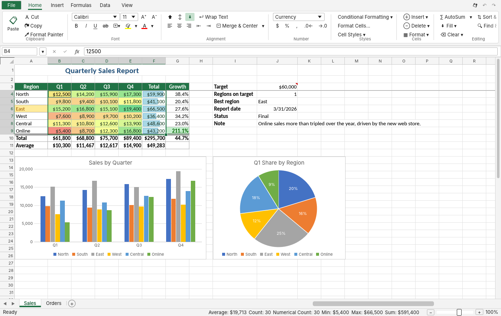

# RExcel

A desktop spreadsheet application written in Rust that aims to replicate Microsoft Excel. It runs on Windows and macOS (and Linux).



## Features

- **Grid**: a full 1,048,576 × 16,384 sheet with frozen panes, merged cells, borders, fills, fonts, wrap and alignment, resizable and hideable rows and columns, zoom, multiple sheets with colored tabs.
- **Formulas**: a parser and calculation engine with Excel's operator precedence, absolute and relative references, cross-sheet references, defined names, dynamic arrays that spill (`A1#`), `LET` and `LAMBDA`, and circular-reference detection.
- **497 worksheet functions** across math, statistics, text, date and time, lookup and reference, dynamic arrays (`FILTER`, `SORT`, `UNIQUE`, `XLOOKUP`, `MAP`, ...), database, financial, engineering and information.
- **Number formats**: the full Excel format-code language (currency, accounting, dates, times, fractions, scientific, conditions, colors).
- **Editing**: undo and redo, cut, copy and paste (also with other apps), Paste Special, the fill handle with series detection, Format Painter, Find and Replace, Go To, function autocomplete and reference highlighting.
- **Data tools**: sort, AutoFilter, remove duplicates, text to columns, data validation lists, Goal Seek, conditional formatting (highlight rules, top/bottom, data bars, color scales).
- **Charts**: column, bar, line, area, pie and scatter.
- **Files**: open and save `.xlsx`, `.csv` and `.tsv`; open `.xls`, `.xlsb` and `.ods`.

## Download

Every push to `main` builds Windows and macOS executables in GitHub Actions (see the **Actions** tab, under the run's *Artifacts*). Pushing a tag like `v0.1.0` publishes them as a GitHub release.

- **Windows**: unzip `rexcel-windows-x64.zip` and run `rexcel.exe`.
- **macOS**: unzip `rexcel-macos-arm64.zip` (Apple Silicon) or `rexcel-macos-x64.zip` (Intel) and open `RExcel.app`. The app isn't signed, so the first time you need to right-click it and choose **Open**.

## Build from source

Install Rust (https://rustup.rs), then:

```sh
cargo run --release -p app              # start RExcel
cargo run --release -p app -- file.xlsx # open a file
cargo run --release -p app -- --demo    # open a sample workbook
cargo test -p engine                    # run the engine tests
```

On Linux you need the usual GUI libraries: `libxkbcommon-dev libgl1-mesa-dev libx11-dev libgtk-3-dev`.

## Layout

- `crates/engine`: the spreadsheet engine with no GUI dependencies: workbook model, formula parser and evaluator, function library, number formats, conditional formats, editing operations and file I/O.
- `crates/app`: the desktop app built with egui/eframe.
